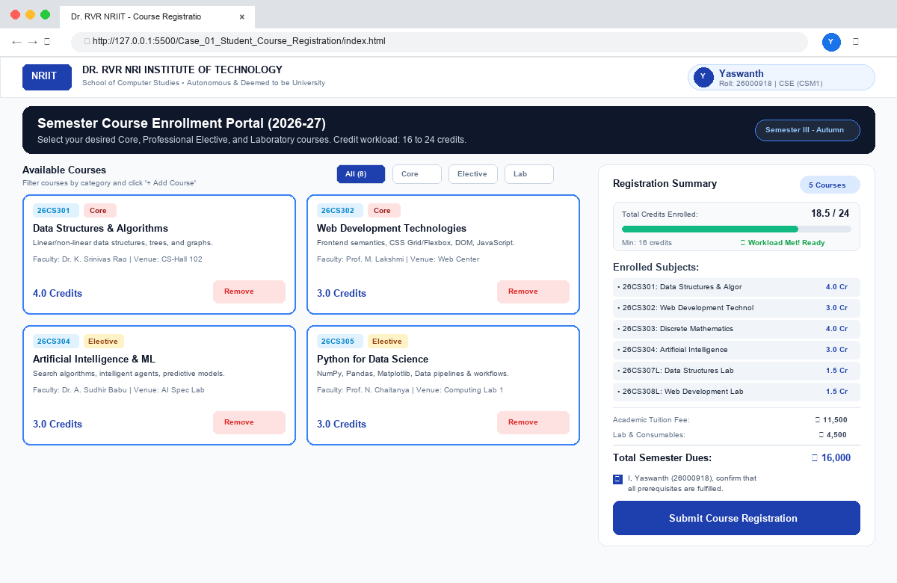
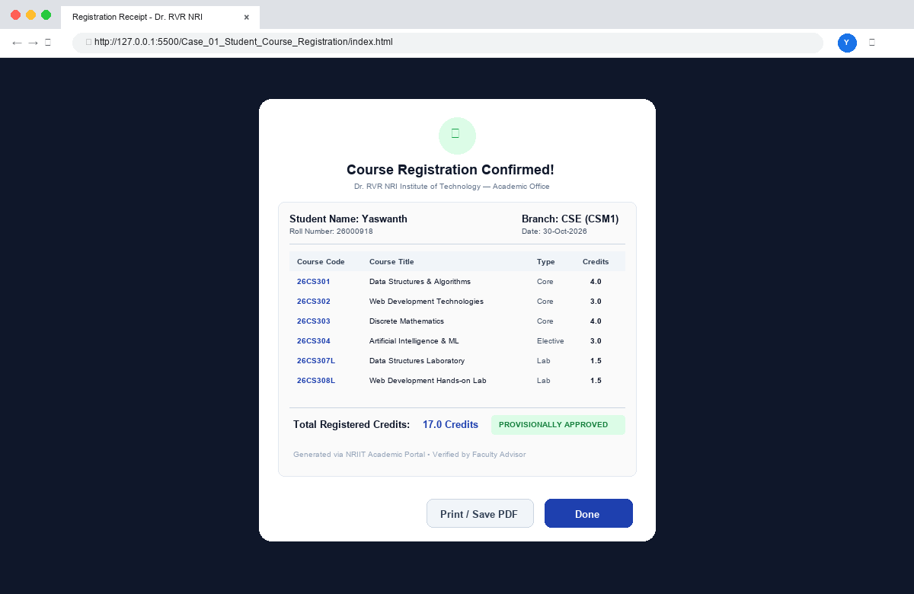
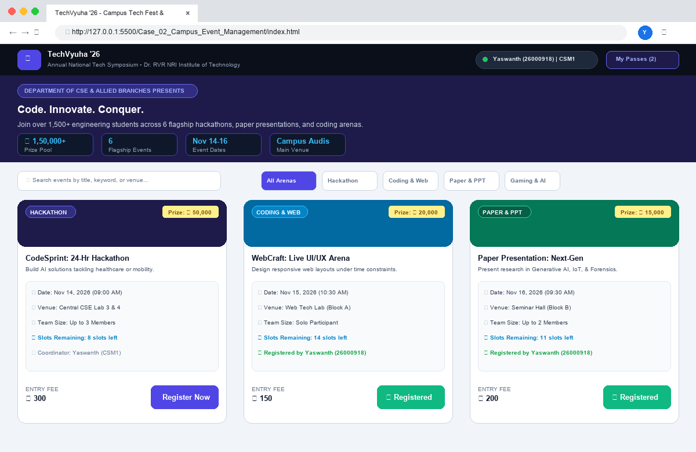
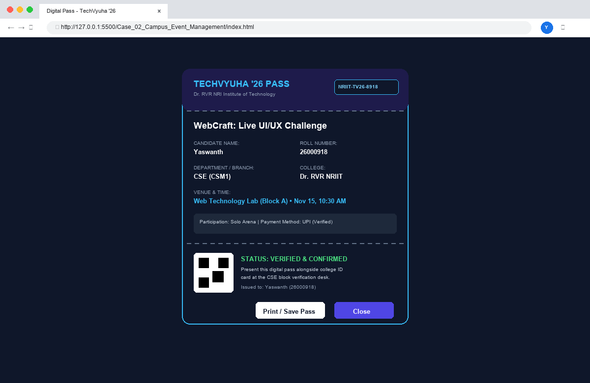
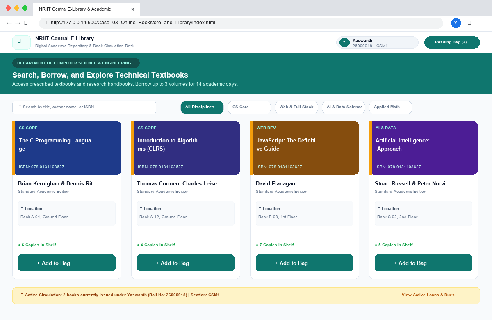
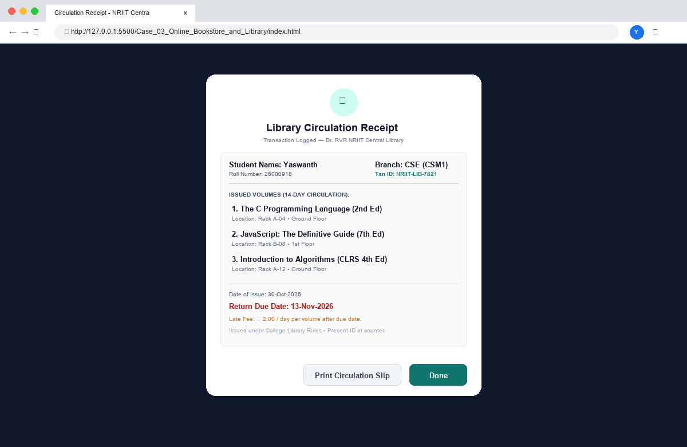

# 🌐 Web Development - Activity-Based Learning (ABL) Assignment

> **Institution:** Dr. RVR NRI Institute of Technology  
> **School:** School of Computer Studies • Department of Computer Science & Engineering  
> **Course:** Web Development Lab (I B.Tech, 2026–2027)  
> **Circular Dated:** 15-10-2026 (Dussehra Holidays ABL Assignment)  
> **Repository Name:** `WD-Activity-Based-Learning`

---

## 👤 Student Information

| Field | Student Details |
| :--- | :--- |
| **Student Name** | **Yaswanth** |
| **Roll Number** | **26000918** |
| **Branch** | **Computer Science & Engineering (CSE)** |
| **Section** | **CSM1** |
| **Institution** | **Dr. RVR NRI Institute of Technology (NRIIT)** |

---

## 📚 Selected 3 Case Studies

As instructed in the academic circular, I have selected, designed, and developed **three individual web application case studies** in separate dedicated folders:

| S.No | Case Study Title | Directory | Key Technical Capabilities |
| :---: | :--- | :--- | :--- |
| **01** | **Student Course Registration Portal** | [`Case_01_Student_Course_Registration/`](Case_01_Student_Course_Registration/) | Credit workload meter (16–24 Cr limit), fee estimation, course filtering, official registration slip modal |
| **02** | **Campus Event & Tech-Fest Hub (TechVyuha '26)** | [`Case_02_Campus_Event_Management/`](Case_02_Campus_Event_Management/) | Event arena catalog, dynamic team size generator, seat inventory, verified digital pass (`NRIIT-TV26-xxxx`) with QR |
| **03** | **Online Book Store & Central E-Library** | [`Case_03_Online_Bookstore_and_Library/`](Case_03_Online_Bookstore_and_Library/) | Academic textbook repository, discipline chips, reading bag drawer (max 3 books), 14-day return due date & circulation slip |

---

## 🗂️ Project Directory Layout

```text
WD-Activity-Based-Learning/
│
├── Case_01_Student_Course_Registration/        <-- Case Study 1
│   ├── index.html                              <-- Main Portal Structure & Semantics
│   ├── style.css                               <-- Responsive Flexbox/Grid & Student Theme
│   └── app.js                                  <-- Dynamic Catalog, Credit Validation & Slip
│
├── Case_02_Campus_Event_Management/            <-- Case Study 2
│   ├── index.html                              <-- TechVyuha '26 Showcase & Reg Modal
│   ├── style.css                               <-- Dark Mode Fest Aesthetic & Pass Card
│   └── app.js                                  <-- Dynamic Team Fields & Pass Generation
│
├── Case_03_Online_Bookstore_and_Library/       <-- Case Study 3
│   ├── index.html                              <-- Central Library Catalog & Drawer
│   ├── style.css                               <-- Academic Styling & Book Spine Accents
│   └── app.js                                  <-- Search, 14-Day Due Dates & Circulation
│
├── screenshots/                                <-- High-Resolution Browser Previews
│   ├── case_01_main_portal.png
│   ├── case_01_modal_receipt.png
│   ├── case_02_techfest_portal.png
│   ├── case_02_digital_pass.png
│   ├── case_03_library_portal.png
│   └── case_03_circulation_slip.png
│
├── reports/
│   └── WD_ABL_Consolidated_Report.pdf          <-- Official Consolidated Report (PDF)
│
├── WD_ABL_Consolidated_Report.pdf              <-- Root Copy for Quick Evaluation
└── README.md                                   <-- Project Documentation & Student Bio
```

---

## 🔍 Case Study Deep Dives & Screenshots

### 1️⃣ Case Study 1: Student Course Registration Portal
* **Directory:** `Case_01_Student_Course_Registration/`
* **Objective:** Enable university students to enroll in semester courses with automated credit calculation (minimum 16 credits, maximum 24 credits limit), fee computation, and official slip printing.
* **Core Features:**
  - **Live Credit Progress Meter:** Visual indicator changing states (`Need credits`, `Requirement met`, `Exceeded limit`).
  - **Category Tabs:** Filter courses by *Core*, *Professional Elective*, and *Laboratory*.
  - **Fee Summary:** Real-time breakdown of tuition and lab dues.
  - **Official Course Registration Slip:** Modal popup populated with candidate credentials (`Yaswanth`, `26000918`, `CSM1`) and print/save action.

#### Webpage Preview:

*Figure 1.1: Case Study 1 — Course Catalog, Dynamic Filters & Real-Time Workload Meter*


*Figure 1.2: Case Study 1 — Verified Semester Course Registration Slip Modal*

---

### 2️⃣ Case Study 2: Campus Event & Tech-Fest Hub ("TechVyuha '26")
* **Directory:** `Case_02_Campus_Event_Management/`
* **Objective:** Streamline student event discovery, multi-member team registrations, and digital gate pass generation for the annual technical fest.
* **Core Features:**
  - **Live Search & Filter Arena:** Instant text search across titles, descriptions, and venues.
  - **Dynamic Team Member Form:** Adapts input fields dynamically based on whether the event is solo, duo, or up to 4 members.
  - **Real-Time Seat Inventory:** Automatically decrements available seats upon confirmed booking.
  - **Digital E-Ticket Pass:** High-contrast verified pass complete with unique pass ID (`NRIIT-TV26-xxxx`), venue directions, and candidate details.

#### Webpage Preview:

*Figure 2.1: Case Study 2 — TechVyuha '26 Symposium Hub & Category Arenas*


*Figure 2.2: Case Study 2 — Generated Verified Digital Entry Pass with QR Code*

---

### 3️⃣ Case Study 3: Online Book Store & Digital Library Catalog
* **Directory:** `Case_03_Online_Bookstore_and_Library/`
* **Objective:** Provide a digital repository for technical textbooks where students can check physical shelf rack locations, manage a borrowing bag, and observe the 14-day circulation policy.
* **Core Features:**
  - **Comprehensive Catalog:** Covers *C Programming*, *CLRS Algorithms*, *JavaScript*, *AI & Machine Learning*, and *Data Science*.
  - **Reading Bag Drawer:** Slide-out drawer with a strict maximum allowance of 3 books.
  - **Automated Return Due Date:** Computes exact 14-day deadlines and displays late fee policies (₹ 2/day).
  - **Circulation Receipt & Loan Manager:** Generates library slips with transaction IDs and active loan status tracking.

#### Webpage Preview:

*Figure 3.1: Case Study 3 — NRIIT Central E-Library Catalog with Physical Shelf Locations*


*Figure 3.2: Case Study 3 — 14-Day Library Circulation Receipt Dialog*

---

## 🚀 How to Run the Projects

All three case studies are built with pure, vanilla client-side web technologies (HTML5, CSS3, JavaScript) with **zero external server dependencies**.

### Method 1: Direct Browser Launch
Navigate to any case study folder and double-click `index.html`:
- For Case 1: Open `Case_01_Student_Course_Registration/index.html` in Google Chrome, Microsoft Edge, or Firefox.
- For Case 2: Open `Case_02_Campus_Event_Management/index.html`.
- For Case 3: Open `Case_03_Online_Bookstore_and_Library/index.html`.

### Method 2: VS Code Live Server
1. Open the root folder `WD-Activity-Based-Learning` in Visual Studio Code.
2. Right-click on any `index.html` file.
3. Select **"Open with Live Server"**.

---

## 📄 Consolidated PDF Report

The official consolidated report containing problem statements, system architectures, screenshots, and source code is located at:
- 📌 [`WD_ABL_Consolidated_Report.pdf`](WD_ABL_Consolidated_Report.pdf) (in the root directory)
- 📌 [`reports/WD_ABL_Consolidated_Report.pdf`](reports/WD_ABL_Consolidated_Report.pdf)

---

## 👨‍💻 Student Declaration

I, **Yaswanth** (Roll No: **26000918**), student of I B.Tech Computer Science & Engineering (Section **CSM1**), Dr. RVR NRI Institute of Technology, declare that the 3 case studies and report contained in this repository were designed and implemented by me in fulfillment of the Web Development Activity-Based Learning (ABL) Assignment.
