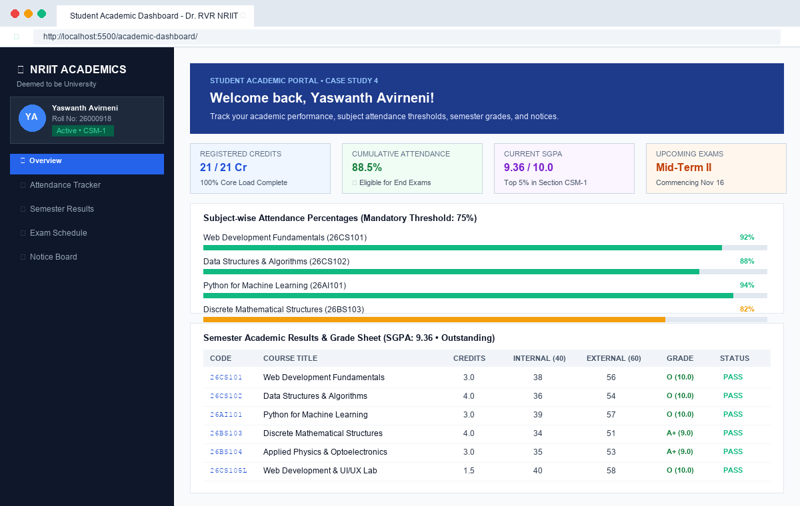
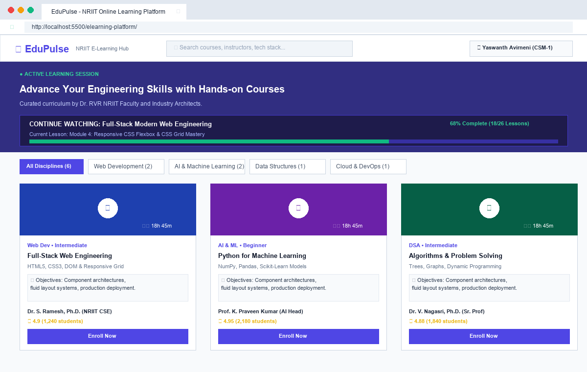
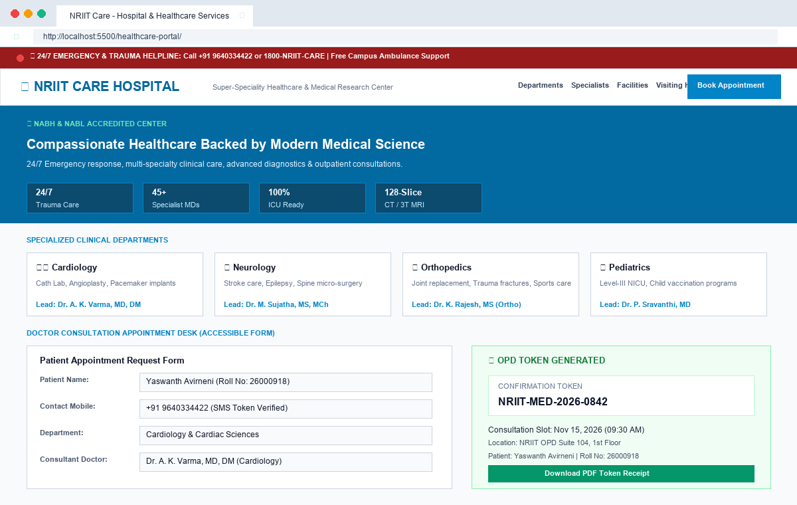

# Web Development Activity-Based Learning (ABL)

## Student Information
- **Name:** Yaswanth Avirneni
- **Roll Number:** 26000918
- **Section:** CSM - 1
- **Branch:** Computer Science & Engineering (AI & ML)
- **Institution:** Dr. RVR NRI Institute of Technology (Deemed to be University u/s 3 of UGC Act, 1956)

---

## Selected Web Development Case Studies

Selected **3 distinct case studies** from the official Dr. RVR NRIIT curriculum sheet, developed strictly using **100% Pure Semantic HTML5 and CSS3** (No JavaScript):

1. **Student Academic Dashboard** (`academic-dashboard/`) - *Case Study 4*
   - Built with a modern fixed sidebar layout, student profile card, and quick KPI metrics (SGPA: 9.36, Credits: 21 Cr, Attendance: 88.5%).
   - Subject-wise attendance progress bars with color-coded safety thresholds (75% min requirement).
   - Structured semester grade results table with course codes, internal (40), external (60), total marks, grade points, and letter grades.
   - Examination schedule timetable with date badges, exam halls, seat numbers, and departmental notice board.

2. **Online Learning Platform Interface** (`elearning-platform/`) - *Case Study 3*
   - Responsive course discovery catalog featuring video lesson thumbnails with play triggers, duration badges, and category pills.
   - Comprehensive learning objectives and syllabus highlights for every course.
   - Verified faculty instructor profiles with star ratings and student counts.
   - Active learning pathway progress tracker (68% complete progress bar).
   - Pure CSS `:target` interactive enrollment modal and confirmation popup with zero JavaScript.

3. **Hospital and Healthcare Services Website** (`healthcare-portal/`) - *Case Study 11*
   - 24/7 Emergency trauma header with ambulance hotline helpline (`9640334422` / `1800-NRIIT-CARE`).
   - Clinical medical departments grid (Cardiology, Neurology, Orthopedics, Pediatrics, Pulmonology, ICU).
   - Consultant doctor directory with qualifications, OPD consultation timings, and room numbers.
   - Inpatient visiting hours matrix table with visitor pass rules and infection control guidelines.
   - Accessible doctor consultation booking form with HTML validation attributes and pure CSS `:target` OPD token receipt popup.

---

## Visual Previews

### 1. Student Academic Dashboard (`academic-dashboard/`)


### 2. Online Learning Platform (`elearning-platform/`)


### 3. Hospital and Healthcare Services Portal (`healthcare-portal/`)


---

## Project Structure
```text
WD-Activity-Based-Learning/
│
├── academic-dashboard/               <-- Case Study 4: Student Academic Dashboard
│   ├── index.html                    <-- Pure Semantic HTML5 Layout & Structure
│   └── style.css                     <-- Sidebar Layout, Progress Bars & Result Tables
│
├── elearning-platform/               <-- Case Study 3: Online Learning Platform Interface
│   ├── index.html                    <-- Course Catalog, Video Thumbnails & Syllabus
│   └── style.css                     <-- Responsive Course Grid & Pure CSS :target Modal
│
├── healthcare-portal/                <-- Case Study 11: Hospital & Healthcare Services
│   ├── index.html                    <-- Clinical Depts, Doctors Directory & Booking Form
│   └── style.css                     <-- Accessible Form Controls, Emergency Bar & Receipt
│
├── screenshots/                      <-- High-Resolution Interface Previews
│   ├── academic_dashboard_preview.png
│   ├── elearning_platform_preview.png
│   └── healthcare_portal_preview.png
│
└── README.md                         <-- Project Documentation & Student Details
```

---

## Technology Stack
- **HTML5:** Semantic elements (`<header>`, `<aside>`, `<main>`, `<section>`, `<article>`, `<table>`, `<form>`, `<label>`).
- **CSS3:** Flexbox, CSS Grid, CSS Custom Properties (Variables), Responsive Media Queries, Keyframe Animations, Pure CSS `:target` Modals.
- **Pure Code:** Zero JavaScript libraries or scripts used.

---

## How to View
Double-click any `index.html` file to view the webpage directly in Google Chrome, Microsoft Edge, Safari, or any modern web browser:
- `academic-dashboard/index.html`
- `elearning-platform/index.html`
- `healthcare-portal/index.html`
